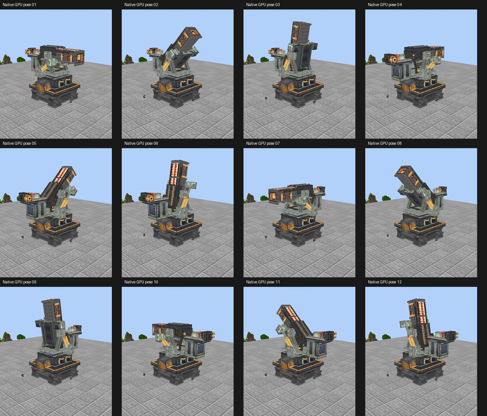
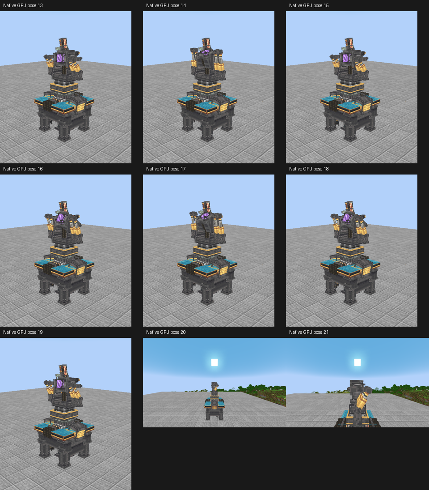

# Create Style Dyson

[下载客户端安装包](https://github.com/Eldershi/create-style-dyson/releases/tag/v1.0.0-mc1.20.1) · [安装说明](INSTALL.md) · [完整模型与贴图](resources/assets/) · [美术源输入](source/)

Minecraft 1.20.1 / Forge 47.4.10 的戴森球客户端视觉实现。本仓库维护完整美术源输入、PNG、模型网格、编译资源快照、自有渲染和构建代码，以及输入/产物哈希和当前需求清单。

仓库包含 `source/` 的49项美术源输入和 `resources/` 的246项编译资源；默认构建不需要外部美术目录。Create 官方仓库讨论记录了社区附属复用美术的说明，已有附属也会直接引用 Create 资源；ARR 标签本身不能作为一律排除的依据。具体来源、引用方式与补充说明见 `THIRD_PARTY_INPUTS.md`。

客户端通过现有 KubeJS / Rhino / Architectury 绘制独立部件，依赖原 Dyson Cube Project Forge 1.0.5.1 与 Titanium 3.8.35。发射器24种模型/30实例，保留回转平台、承托、双液压和折返线缆；接收器25种模型/47实例，保留0～70°机械行程并按原native角驱动，视觉yaw固定0，不声称是180°机械行程。

原DCP自身缺陷只记录，不修改其工作逻辑、能量规则或原蓝色全息效果；本项目修复范围是资源替换和客户端脚本自身引入的问题。原充能、发射及相关特效由原Java渲染器提供，炮身输入坐标的20像素对齐保持。炮尾门常闭，不增加装填、退座或开门动作。

使用Python3.12、Pillow12.3.0、numpy2.3.5、Node.js24.19.0构建：

```sh
python3 -m pip install -r requirements.txt
python3 tools/check_public_tree.py
python3 build.py
```

输入布局见 `input-layout.md`，文件SHA列在 `source-input-lock.json`。构建读取仓库输入，生成并验证 `outputs/` 中的246项资源、匹配ZIP与客户端脚本。`tools/extract_reference.py` 可从本地依赖JAR提取并核对单个参考文件；运行时引用与将素材副本装入ZIP分别登记，保留来源及对应许可说明。

`client/kubejs/startup_scripts/90_dcp_approved_visuals.js` 是生成的客户端代码，必须与对应资源包配套。ZIP由仓库内源文件确定性构建，SHA见 `artifact-lock.json`。整合包仓库只保存本仓库的提交引用、包/脚本SHA及Paxi集成配置。实装使用单份Paxi资源包并保留其它包顺序。

`artifact-lock.json` 记录构建产物，`resource-hashes.json` 记录 `resources/` 中全部资源的哈希。`validation-report.json` 独立说明实际验证范围；原始游戏PNG留在本地，仅在报告中绑定哈希与状态。构建与数值测试不等同于完整395模组、原生工作状态或外观验收。全部当前要求见 `requirements-checklist.md`。

## 实机预览

以下预览由当前实装版本的游戏截图整理。





来源与署名见 [CREDITS.md](CREDITS.md)，适用的美术许可见 [ASSET-LICENSES.md](ASSET-LICENSES.md)。下载包随附这些说明，相关上游权利及改编条件保留。
