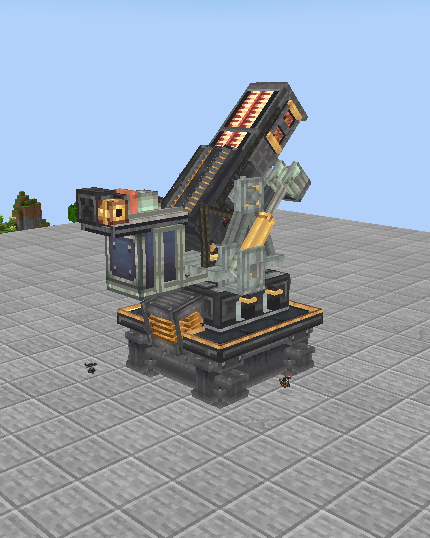
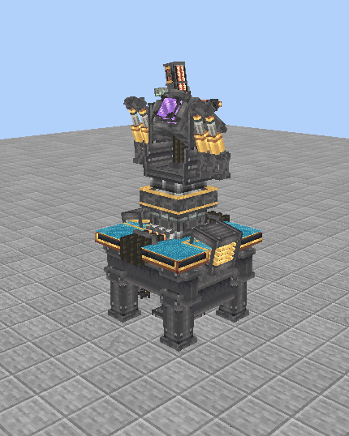

[English](README.md) · **简体中文**

# Create Style Dyson

为戴森球模组的电磁发射器和射线接收器换上机械动力风格的模型与贴图。金属机架、线圈、线缆与可活动的黄铜液压结构，让两台机器更有机械感，同时保留原有的发射和发电功能。

| 电磁发射器 | 射线接收器 |
| :---: | :---: |
|  |  |

## 使用要求

| Minecraft | 模组加载器 | Java |
| --- | --- | --- |
| Java版 1.20.1 | [Forge 47.4.10](https://files.minecraftforge.net/net/minecraftforge/forge/index_1.20.1.html) | [17](https://adoptium.net/temurin/releases/?version=17) |

本版本适用于 **Forge**，目前不提供 Fabric 或 NeoForge 版本。

请先把以下模组放入客户端的 `mods/` 文件夹。链接均指向对应的 Forge 版本；整合包已包含这些模组时，无需重复安装。

| 必需模组 | 下载 |
| --- | --- |
| Dyson Cube Project (Forge) | [1.0.5.1](https://www.curseforge.com/minecraft/mc-mods/dyson-cube-project-forge/files/9025750) |
| Titanium | [3.8.35](https://www.curseforge.com/minecraft/mc-mods/titanium/files/8426836) |
| KubeJS | [2001.6.5-build.26](https://www.curseforge.com/minecraft/mc-mods/kubejs/files/8020595) |
| Rhino | [2001.2.3-build.10](https://www.curseforge.com/minecraft/mc-mods/rhino/files/6186971) |
| Architectury API | [9.2.14](https://www.curseforge.com/minecraft/mc-mods/architectury-api/files/5137938) |

## 安装方法

**资源包和附带的客户端脚本需要一起安装。**

1. 在启动器中打开 Minecraft 1.20.1 的 Forge 实例，并选择 Java 17。复制文件前先关闭游戏。
2. 在启动器中点击 **打开游戏目录**，进入当前实例的文件夹，把前置模组的 `.jar` 文件放进其中的 `mods/` 文件夹。
3. [下载客户端安装包](https://github.com/Eldershi/create-style-dyson/releases/download/v1.0.1-mc1.20.1/Create-Style-Dyson-1.0.1-MC1.20.1-Client.zip)，然后解压下载的压缩包。
4. 在其中的 `config/paxi/resourcepacks/` 找到 `Dyson-Create-Approved-Models-Forge-1.20.1.zip`，复制到游戏目录的 `resourcepacks/` 文件夹。**这个内层 ZIP 不要解压。**
5. 把 `kubejs/startup_scripts/` 中的 `90_dcp_approved_visuals.js` 复制到游戏目录的同名文件夹；没有该文件夹时手动新建。
6. 启动游戏，进入 **选项 → 资源包**，启用本资源包，并将它放在其他修改这两台机器的资源包上方。

安装或更新脚本后需要完整重启客户端，仅重载资源包不会加载脚本。

客户端已经使用 Paxi？

1. 把下载包中的内层资源 ZIP 复制到游戏目录的 `config/paxi/resourcepacks/`。
2. 把附带的客户端脚本复制到 `kubejs/startup_scripts/`。
3. 打开 `config/paxi/resourcepack_load_order.json`，保留已有条目，在 `loadOrder` 列表末尾加入 `Dyson-Create-Approved-Models-Forge-1.20.1.zip`。
4. 完整重启客户端。使用 Paxi 安装时，不必再向 `resourcepacks/` 放第二份相同 ZIP。

卸载时，一并移除资源 ZIP 和 `90_dcp_approved_visuals.js`。

[制作与来源署名](CREDITS.zh-CN.md) · [美术许可](ASSET-LICENSES.zh-CN.md)
